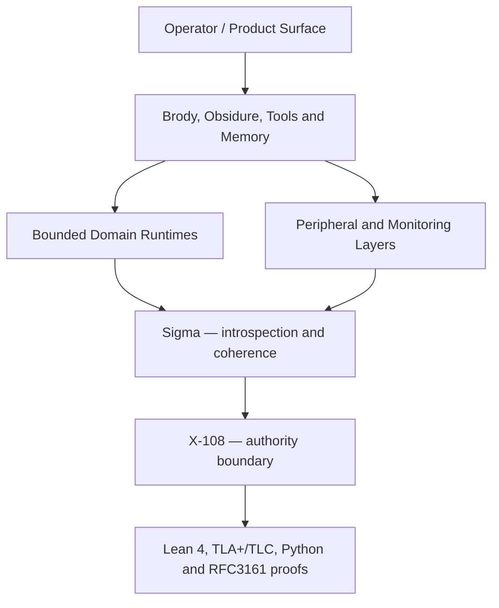

# Obsidia X-108 — Public Proof Perimeter

> Reproducible public proofs for the authority kernel of Obsidia.

Obsidia is a governed cognitive operating system. Its components may propose, search, remember, synthesize, verify, and execute through bounded adapters. **X-108 remains the final authority boundary.**

This repository exposes the reproducible public proof and verification perimeter of that kernel. It is **not** the complete proprietary Obsidia system.

## Why X-108 exists

Modern AI systems often blur four different operations:

1. producing a plausible answer;
2. deciding what should happen;
3. authorizing an irreversible action;
4. proving what actually happened.

Obsidia separates them.

```text
Cognition → Intention → Decision → Action → Proof
```

A model, agent, memory system, domain adapter, or monitoring layer may contribute information. None of them automatically receives authority from being intelligent.

## Where this repository sits



The diagram shows the wider architectural context. This repository publishes the **X-108 proof perimeter**, a **minimal public Sigma slice**, and the verification chain around them. The complete product stack shown above is not published here.

## Core distinction

| Component type | May propose or measure | May authorize |
|---|---:|---:|
| Model, agent, or operator layer | Yes | No |
| Memory or retrieval layer | Yes | No |
| Domain adapter | Yes | No |
| Sigma monitoring layer | Yes | No |
| Lean / model checking / executable verifier | Proves a property | No |
| X-108 authority boundary | Evaluates the governed structure | Yes, within its contract |

**Proof is not authority. Intelligence is not authority. X-108 is the authority boundary.**

## What is public here

This repository contains:

- Lean 4 formal proofs;
- TLA+ specifications and TLC model checking;
- Python executable verifiers;
- a minimal public Sigma layer;
- RFC3161 schema and anchor checks;
- cross-platform QA for RFC3161, TLC, and Sigma;
- public examples and smoke tests;
- the end-to-end public runner.

```powershell
.\run_all_proofs.ps1
```

## What is outside this repository

This repository does not contain:

- the complete proprietary production engine;
- the complete production Sigma system;
- the full Brody, Obsidure, memory, and product stack;
- complete banking, trading, e-commerce, GPS, aviation, or other production adapters;
- the final operator cockpit;
- permanent control over third-party timestamping infrastructure.

These exclusions are scope boundaries, not missing claims inside P1.

## Canonical P1 audit target

P1 is closed and publicly frozen.

| Reference | Value | Meaning |
|---|---|---|
| Official freeze tag | `p1-freeze-2026-04-22` | Canonical public P1 audit target |
| Public freeze commit | `99e966a` | Public closure pack and readable frozen perimeter |
| Technical closure commit | `bd87e15` | Closure of the technical P1 shadow zones |

`main` is an active continuation branch. It may contain post-freeze work, including P2-bank and later public packs. It does not redefine the frozen P1 perimeter.

For an external P1 audit, use the tag and freeze commit above.

## Quick start

### Prerequisites

- Python 3.11 or later recommended;
- Java 17 or later;
- Lean 4 and Lake;
- `tla2tools.jar` available in `%USERPROFILE%`;
- PowerShell on Windows for the public runner.

### Run the full public verification chain

```powershell
git clone https://github.com/Eaubin08/obsidia-x108-proofs.git
cd obsidia-x108-proofs
git checkout p1-freeze-2026-04-22
.\run_all_proofs.ps1
```

## Expected result

A successful P1 public run should produce:

- TLC: no error found;
- Lean: build completed successfully;
- `verify_all.py`: PASS;
- `verify_decision.py`: VALID on canonical scenarios;
- public Sigma tests: PASS;
- RFC3161 anchor schema: PASS;
- cross-platform QA: PASS;
- final runner line: `=== DONE ===`.

## Repository map

| Path | Purpose |
|---|---|
| `lean/` | Formal Lean 4 proof perimeter |
| `tla/` | TLA+ specifications and TLC models |
| `verifier/` | Executable Python verification |
| `sigma/` | Minimal public Sigma implementation and tests |
| `qa/` | Cross-platform and integration QA |
| `docs/` | Scope, limits, architecture, and audit documentation |
| `run_all_proofs.ps1` | Public end-to-end verification runner |

See `docs/REPO_MAP.md` for the detailed map.

## Recommended reading paths

### Understand the perimeter

1. `README.md`
2. `docs/status/PUBLIC_STATUS.md`
3. `docs/PROOF_SCOPE.md`
4. `docs/LIMITS.md`
5. `docs/REPO_MAP.md`

### Reproduce P1

1. `docs/status/P1_FREEZE_NOTE.md`
2. `docs/P1_FREEZE_AUDIT_READABILITY_NOTE.md`
3. `run_all_proofs.ps1`
4. the generated verification results

### Inspect Sigma

1. `docs/SIGMA.md`
2. `sigma/run_pipeline.py`
3. `sigma/sigma_monitor.py`
4. `sigma/tests/`

### Inspect RFC3161 checks

1. `docs/RFC3161.md`
2. `qa/cross-platform/test_rfc3161_cross_platform.py`
3. `qa/cross-platform/test_rfc3161_anchor_schema.py`

## Current `main` hygiene state

`main` continues after the public hygiene freeze of 26 May 2026.

Current documented boundaries include:

- no kernel mutation;
- no X-108 merge;
- no Graphiti reduction;
- public documentation alignment only for the cleanup perimeter;
- full readonly Graphiti records retained until a tested lighter dataset exists.

Relevant status documents:

- `docs/status/PUBLIC_REPO_CLEANUP_FREEZE_20260526.md`
- `docs/status/README_STATUS_INDEX.md`
- `docs/status/PERIPHERY_PUBLIC_INDEX.md`
- `docs/status/GRAPHITI_FULL_RECORDS_KEEP_DECISION.md`

## Who this repository is for

- technical auditors;
- engineers evaluating deterministic governance;
- researchers working on proof, model checking, and bounded AI authority;
- laboratories and partners evaluating the reproducible P1 perimeter.

## Claims and limits

This repository demonstrates a reproducible public proof perimeter. It does not claim:

- that every Obsidia component is public;
- that every domain is production-ready;
- that external timestamping services are permanently available;
- that a proof layer alone constitutes a complete business application;
- that Sigma, Brody, a model, or a domain adapter can bypass X-108.

## Status

**P1: closed and publicly frozen.**

- Canonical tag: `p1-freeze-2026-04-22`
- Public freeze commit: `99e966a`
- Active continuation branch: `main`
